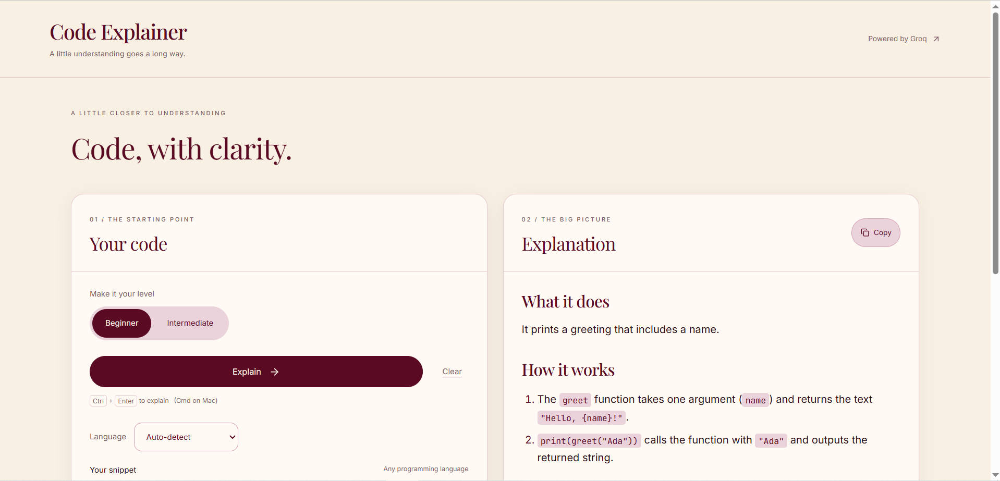
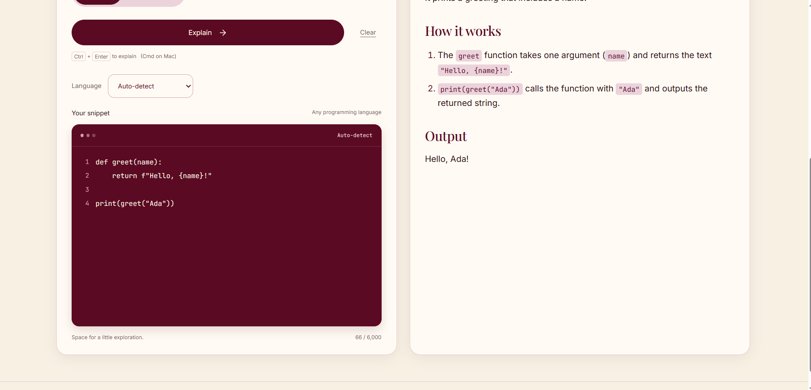

# Code Explainer

A responsive AI Code Explainer built with Django REST, React, Vite, Tailwind, and Groq streaming. Paste code, choose a learning level, and understand it in simple English.
**Live demo:** https://code-explainer-app-bice.vercel.app

## Screenshots




## Features

- Split view with code input on the left and streaming markdown explanations on the right; stacked panels on mobile.
- Beginner and intermediate explanation levels, a 6,000-character counter, Explain and Clear buttons.
- Four explanation parts: what it does, a line-by-line walkthrough, tiny input/output example, and one improvement tip.
- Three example snippets fill the editor without sending a request.
- Syntax-highlighted code blocks and copy controls for code and the full explanation.
- Loading status, friendly errors, and Retry using the original code and level. Clear cancels an active request.
- In-memory state only: refreshing or clearing removes the code and explanation.

## Stack

Python 3.10+ · Django 5.2 · Django REST Framework · django-cors-headers · python-dotenv · Groq SDK · React 19 · Vite 7 · Tailwind CSS 4 · Framer Motion · react-markdown · react-syntax-highlighter · lucide-react. Use Node.js 22.12+ or 24 LTS.

## Windows setup

Open PowerShell in this project folder. `npm.cmd` avoids PowerShell execution-policy issues. Calling the virtual environment's Python directly also avoids needing to activate it.

### Backend

```powershell
cd backend
py -m venv venv
.\venv\Scripts\python.exe -m pip install -r requirements.txt
if (!(Test-Path .env)) { Copy-Item .env.example .env }
notepad .env
```

Get a free Groq API key by signing in at [Groq Console](https://console.groq.com/keys), selecting **Create API key**, and copying the key into `GROQ_API_KEY` in `backend/.env`. Free accounts have usage limits; availability and limits are controlled by Groq. See the [official quickstart](https://console.groq.com/docs/quickstart). Never put the key in a frontend environment variable or commit `.env`.

Then run:

```powershell
.\venv\Scripts\python.exe manage.py check
.\venv\Scripts\python.exe manage.py test
.\venv\Scripts\python.exe manage.py runserver
```

The API runs at `http://localhost:8000/api/explain/`. No migrations are needed for this stateless endpoint.

### Frontend (second PowerShell terminal, from the project root)

```powershell
cd frontend
npm.cmd install
if (!(Test-Path .env)) { Copy-Item .env.example .env }
npm.cmd run dev
```

Open **http://localhost:5173** or **http://127.0.0.1:5173**. Keep both terminals running; Ctrl+C stops each server. During development, an unset or blank `VITE_API_URL` sends requests through Vite's `/api` proxy to `http://127.0.0.1:8000`; production builds default to `http://localhost:8000`. Set `VITE_API_URL` to call another backend directly. Restart Vite after changing its environment. Django permits both local frontend origins through CORS.

If Groq reports the model is unavailable, set `GROQ_MODEL` in `backend/.env` to an accessible text model from your Groq Console and restart Django. The default remains `openai/gpt-oss-20b`.

```powershell
# Production frontend compilation
npm.cmd run build
```

## API and limits

POST `/api/explain/` with JSON:

```json
{"code":"def greet(name):\n    return f'Hello, {name}!'\n\nprint(greet('Ada'))", "level":"beginner"}
```

`code` is required and must be a non-blank string of at most 6,000 characters, including whitespace. Indentation is preserved. `level` is required and must be `beginner` or `intermediate`. Invalid requests return HTTP 400 with a clear `error` and field `details`; a missing Groq key returns HTTP 503.

Successful responses use SSE: `data: {"content":"..."}` frames followed by `data: {"done":true}`. Provider failures use `data: {"error":"..."}`. Each frame ends with two newlines. The server supplies the four-part markdown system prompt and the selected learning level. The default model remains `openai/gpt-oss-20b`.

Each request explains one snippet without conversation history. Partial explanations remain visible after an error. Retry replaces the explanation using the original request, even if you edit the input afterward. You can also edit the code or level and click Explain for a new request. Output is capped at 8,000 tokens; requests time out after 45 seconds without activity. Ctrl+Enter (or Command+Enter) submits; Enter inserts a new line.

## Configuration and deployment

All palette colors live in `frontend/src/index.css`; brand and small labels use JetBrains Mono, body text uses Inter via Google Fonts, and the empty-state heading adds a Georgia serif accent. Tailwind is available alongside component styles. The streaming logic is isolated in `src/hooks/useChat.js`.

`DEBUG` defaults to false; `.env.example` enables it for local development. For a deployment, set `DEBUG=False`, a stable random `SECRET_KEY`, and appropriate `ALLOWED_HOSTS`; configure your frontend origin in Django's `CORS_ALLOWED_ORIGINS`. Serve behind HTTPS with a production WSGI server, disable proxy buffering for SSE, and allow enough worker capacity for long-lived streams. Django's development server is for local use. Before exposing a shared API publicly, add authentication and per-user request quotas at your application or gateway to protect your Groq allowance. This starter has no accounts or persistent code or explanation storage.

## Deploy on Vercel

Import the repository as a Vercel project on the **Hobby** plan. Set **Root Directory** to `backend` and **Framework Preset** to **Other**. Leave Build Command and Output Directory unset: `vercel.json` explicitly uses `@vercel/python` and routes every request to `config/wsgi.py`, which exports `app`. Vercel installs the five packages in `requirements.txt`; no Gunicorn, migrations, or static collection are required.

Set these environment variables in Vercel before deploying:

- `DEBUG=False`
- `SECRET_KEY`: a generated private random secret
- `GROQ_API_KEY`: your private Groq API key
- `ALLOWED_HOSTS=your-backend.vercel.app` (or `.vercel.app` for Vercel subdomains; comma-separated)
- `CORS_ALLOWED_ORIGINS=https://your-frontend.vercel.app` (exact frontend origins, comma-separated, with no trailing slash)

Deploy the frontend separately with `VITE_API_URL=https://your-backend.vercel.app` and rebuild it. The API remains `/api/explain/`; `/` has no page. The backend disables database access and needs no SQLite file. Local `.env` files are excluded from CLI uploads by `.vercelignore`; store deployed secrets in Vercel settings.

The Python runtime supports streaming, but responses must complete within the function duration allowed by your Hobby project's configuration. See the [Python runtime](https://vercel.com/docs/functions/runtimes/python) and [function limits](https://vercel.com/docs/functions/limitations). This configuration preserves the existing SSE logic; verify token streaming with a live request after deployment.

## Screenshots

_Add desktop and mobile screenshots of your running app here._

## Source file inventory

```text
.gitignore
README.md
backend/
  .env.example
  .gitignore
  requirements.txt
  vercel.json
  .vercelignore
  manage.py
  config/
    __init__.py
    settings.py
    tests.py
    urls.py
    wsgi.py
    asgi.py
  chat/
    __init__.py
    apps.py
    serializers.py
    urls.py
    views.py
    tests.py
frontend/
  .env.example
  .gitignore
  package.json
  package-lock.json
  index.html
  vite.config.js
  src/
    main.jsx
    App.jsx
    index.css
    hooks/useChat.js
    components/
      Header.jsx
      CopyButton.jsx
      MessageList.jsx
      MessageBubble.jsx
      TypingIndicator.jsx
      ChatInput.jsx
      SuggestionChips.jsx
      EmptyState.jsx
```

Installation also generates ignored `backend/venv/`, `frontend/node_modules/`, Python caches, and `frontend/dist/`. These are build/dependency artifacts, not source files.
